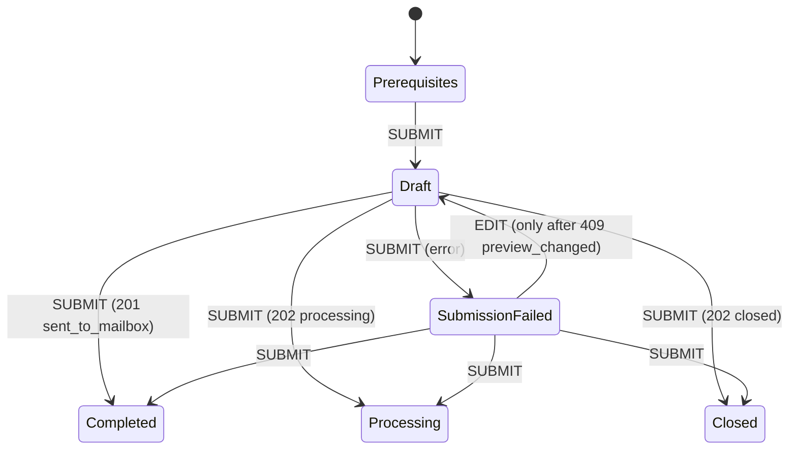

# Employment certificate for government jobs (Starfsvottorð)

## About

Application for an employment certificate for government jobs ("Sækja um starfsvottorð vegna starfa hjá ríkinu") from Fjársýsla ríkisins (the Financial Management Authority). It replaces the legacy form on `leyfisumsokn.island.is`.

The applicant sees the government institutions they have worked for, chooses which of them go on the certificate, can choose to show their trade union, and can add a comment if something is missing or wrong. Fjársýsla ríkisins generates the certificate, stamps it electronically and delivers it to the applicant's Digital Mailbox (Pósthólf). A comment, or a history that can't be issued automatically, goes to Fjársýsla ríkisins staff, who finish the case without asking the applicant again.

Status: the application calls Fjársýsla ríkisins' API. Deployed environments can't reach it until the X-Road service exists, so for now it only runs locally (see "Running against Fjársýsla ríkisins' API"). It is behind the feature flag `isEmploymentCertificateApplicationEnabled`.

- [Template-api-module](https://github.com/island-is/island.is/blob/main/libs/application/template-api-modules/src/lib/modules/templates/fjs/employment-certificate)
- [API client](https://github.com/island-is/island.is/blob/main/libs/clients/fjs/employment-certificate)

## URLs

- [Local](http://localhost:4242/umsoknir/starfsvottord)
- [Dev](https://beta.dev01.devland.is/umsoknir/starfsvottord)
- [Production](https://island.is/umsoknir/starfsvottord)

## States



The submit action runs when the applicant leaves the draft (`onExit`, `throwOnError: false`), and its result decides the next state. A failed submit needs its own state: if no transition matched, the application would stay in draft and the form would go back to the first screen without an error.

| State              | Overview status | Lifecycle (placeholder until retention is agreed) |
| ------------------ | --------------- | ------------------------------------------------- |
| `prerequisites`    | draft           | ephemeral                                         |
| `draft`            | draft           | pruned after 2 days                               |
| `submissionFailed` | draft           | pruned after 2 days                               |
| `completed`        | completed       | pruned after 90 days                              |
| `processing`       | completed       | pruned after 90 days                              |
| `closed`           | rejected        | pruned after 90 days                              |

### Prerequisites (Gagnaöflun)

- `NationalRegistryV3UserApi`: name and national ID
- `UserProfileApi`: email
- `EmploymentEligibilityApi`: `GET /employment-history/eligibility`. Fails with "Engar upplýsingar fundust" when the applicant has no history, so they can't continue. Not stored.

### Draft

- **Persónuupplýsingar:** name, national ID and email, all read-only. The email comes from the user profile and may be empty. A box links to Mínar síður for changing it.
- **Starfsferill:**
  - The custom field `EmploymentHistory` fetches the history with `EmploymentHistoryPreviewApi` every time the screen opens, without storing it. It shows one row per institution with a checkbox (cards on mobile), all ticked by default. At least one must stay ticked.
  - The answers keep `previewVersion` and the ticked `institutionIds`. When the history is fetched again, only IDs still in it are kept.
  - `includeUnion` (checkbox) and an optional `comment` (at most 4,000 characters).
  - If the history can't be fetched, submitting is blocked, and the screen offers a retry and the support email.

### Submission failed

"Reyna aftur" sends the same answers again, because a retry reuses the idempotency key. Only after `409 preview_changed` does the applicant go back to the history ("Skoða starfsferil") instead.

A failed retry doesn't throw either. The application stays in this state, and the form fetches it again (`refetchApplicationAfterSubmit`), so the screen shows the latest result. With `throwOnError: true` the form would only show a toast and keep the old screen: after a `409 preview_changed` on a retry, "Skoða starfsferil" would not appear until the page was reloaded.

The submit action maps the API's answers to the statuses the template acts on:

| API answer                                                                | Template API error | Screen                                      |
| ------------------------------------------------------------------------- | ------------------ | ------------------------------------------- |
| `409 preview_changed`                                                     | `409`              | Submission failed, with "Skoða starfsferil" |
| Any other error answer (`400`, `404`, `409` without a code, `413`, `500`) | `502`              | Submission failed                           |
| No answer (not configured, network error, timeout)                        | `503`              | Submission failed                           |

In the applications overview, a failed application looks like any draft ("Umsókn í vinnslu hjá þér" with a progress bar): the platform shows no pending action or history on cards of draft-status states (`libs/application/ui-components/src/components/ApplicationCard/utils/history.tsx`). Like a draft, it is pruned after 2 days.

### Completed, processing and closed

- **Completed:** the certificate is in Pósthólf. The screen links to the document (`/minarsidur/postholf/<documentId>`).
- **Processing:** "Umsókn móttekin – í vinnslu", or "– athugasemd í yfirferð" with the comment when there is one. The application doesn't check the status again, so the state is final.
- **Closed:** "Yfirferð lokið – ekki hægt að gefa út vottorð". Only returned when a key is replayed for a case staff have closed.

## External services

Fjársýsla ríkisins' employment-certificate API (v4.0.0), through X-Road once the connection exists. The client is `@island.is/clients/fjs/employment-certificate`. Every call is made as the applicant; the API reads the person from the token.

| Template API action           | API call                                                                                             | Stored                                   |
| ----------------------------- | ---------------------------------------------------------------------------------------------------- | ---------------------------------------- |
| `getEmploymentEligibility`    | `GET /employment-history/eligibility`                                                                | No                                       |
| `getEmploymentHistoryPreview` | `GET /employment-history/preview`                                                                    | No                                       |
| `submitApplication`           | `POST /employment-history/requests` (`previewVersion`, `institutionIds`, `includeUnion`, `comment?`) | `caseId`, `deliveryStatus`, `documentId` |

`submitApplication` sends the application's ID as the `Idempotency-Key`, so every retry of an application returns the same case. It audits and logs the case ID and delivery status, never the comment.

## Running against Fjársýsla ríkisins' API

Until the X-Road service exists, a local run calls the API directly. That needs network access to the API (Fjársýsla ríkisins allows specific addresses only) and its base URL in the environment of the application-system API, set before starting it. Don't commit the URL.

```bash
export FJS_EMPLOYMENT_CERTIFICATE_DIRECT_URL=<base URL of the API>
yarn dev application-system-form
```

The direct URL is ignored when `NODE_ENV` is `production`, so deployed environments only use X-Road. Without a base URL, or when the API refuses the call, the screens show the "service unavailable" state. The API module logs the status, error code and request ID of a failed call.

## Test users

Digital Iceland's fake persons (Gervimenn). Refer to them by name, never by national ID. In Fjársýsla ríkisins' test data:

- **Gervimaður Ameríka:** a valid history; the certificate should be delivered automatically.
- **Gervimaður Evrópa:** a negative employment percentage; the request goes to staff (`processing`).
- **Gervimaður Afríka:** no history; the eligibility check blocks the application.

## Decisions

- **Individuals only, no delegations.** The API only takes a person's own IAS token. Decided by Fjársýsla ríkisins, 06.11.2026.
- **The history is fetched for display and never stored.** Only `previewVersion` and the ticked institution IDs are saved; the API binds the request to the version the applicant saw. Decided by Fjársýsla ríkisins and the development team, 06.11.2026.
- **The email is read-only and optional.** It comes from the user profile, isn't sent to Fjársýsla ríkisins, and a changed email would need verification on Mínar síður. Decided by the development team after a meeting with Fjársýsla ríkisins, 13.11.2026.
- **No history blocks the application at data collection.** `GET /eligibility` runs before the application screens, as the API asks. Decided by Fjársýsla ríkisins, 13.11.2026.
- **Institution selection.** All institutions are ticked by default; at least one must stay ticked, because the API rejects an empty list. Decided by Fjársýsla ríkisins, 13.11.2026.
- **The trade union is optional.** Unticked by default; the union names appear only on the PDF and never in island.is. Decided by Fjársýsla ríkisins, 13.11.2026.
- **Optional comment.** A plain text area of at most 4,000 characters; a comment sends the application to manual review. It is never logged. Decided by Fjársýsla ríkisins, 13.11.2026.
- **No status pages, no status refresh and no re-approval.** The result screen shows the submit answer and nothing more; staff finish manual cases without asking the applicant again. Decided by Fjársýsla ríkisins, 13.11.2026.
- **Processing counts as completed in the applications overview, and closed as rejected.** Since the status is never checked again, an "in progress" card would stay until the application is pruned. Decided by the development team, 13.11.2026.
- **Applications stay listed.** Earlier applications appear at `/umsoknir/starfsvottord` and in the applications overview on Mínar síður, as the platform does by default. Decided by the development team, 13.11.2026.
- **A failed submit is retried with unchanged answers.** The API answers `409` when the same idempotency key comes with a different body, so going back to the history is only offered after `409 preview_changed`. Decided by the development team, 13.11.2026.
- **When the history lookup fails, the applicant is blocked.** The screen offers a retry and the support email; the design also proposes letting the applicant continue, which isn't decided. Decided by the development team, 09.11.2026.
- **The success screen links straight to the document in Pósthólf.** `documentId` is the mailbox document ID. Confirmed by Fjársýsla ríkisins, 13.11.2026.

## Localization

Translation namespace: `fjs.ec.application` (plus `uiForms.application`). Texts are in `src/lib/messages.ts`; extract them to Contentful with:

```bash
yarn nx run employment-certificate:extract-strings
```

## Running unit tests

```bash
yarn test employment-certificate
yarn nx test application-template-api-modules --testPathPatterns=fjs/employment-certificate
```

## Running the e2e smoke test

`apps/system-e2e/src/tests/islandis/application-system/smoke/employment-certificate.spec.ts` logs in as Gervimaður Ameríka (the history is shown, every institution ticked) and Gervimaður Afríka (stopped at data collection). It never submits, because every submit creates a real case and mailbox document at Fjársýsla ríkisins.

Locally, start the application against the API as above, then:

```bash
yarn playwright install chromium # once
PORT=4242 yarn system-e2e --project=islandis 'application-system/smoke/employment-certificate'
```

On dev it passes only once the API is reachable through X-Road.
