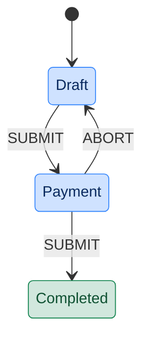

# PAY DEBTS APPLICATION

## About

Application for paying debts owed to the Icelandic state ("Greiðum
ríkinu", `ApplicationTypes.PAY_DEBTS`, slug `greidum-rikinu`). The
applicant picks up one or more outstanding debts fetched from Fjársýsla
ríkisins (FJS) and pays the selected debts via the standard payment flow.

A debt can currently only be paid in full — there is no per-row partial
amount.

- [Template-api-module](https://github.com/island-is/island.is/blob/main/libs/application/template-api-modules/src/lib/modules/templates/pay-debts/pay-debts.service.ts)
- [Finance v3 client (X-Road)](https://github.com/island-is/island.is/tree/main/libs/clients/finance-v3)

## Decisions

- **Debts are paid in full.** Partial payment is left out for now, but its
  code is kept: the commented-out `inputColumn` in `debtsSection.ts` (a
  per-row amount saved as `debtsToPay`), the footer total beside it, and
  `getAmountToPay` in `getSelectedDebts.ts`, which clamps a typed amount.
  Re-enable them to bring partial payment back. Clearing a row's amount
  then unchecks the row; this is intended.
- **Up to 100 debts.** The flow supports at most 100 debts per applicant
  for now. FJS returns them all in one response, so `nextKey` paging is
  not used.

## URLs

- [Local - http://localhost:4242/umsoknir/greidum-rikinu](http://localhost:4242/umsoknir/greidum-rikinu)
- [Dev - https://beta.dev01.devland.is/umsoknir/greidum-rikinu](https://beta.dev01.devland.is/umsoknir/greidum-rikinu)
- [Production - https://island.is/umsoknir/greidum-rikinu](https://island.is/umsoknir/greidum-rikinu)

## States



### Draft

The only state the applicant actively fills in. Data fetching from:

- **Finance v3 (FJS)** — `getCustomerDebts` fetches the applicant's
  outstanding debts via X-Road. See [Setup § X-Road](#x-road) below.

The applicant sees a table of debts (`DebtsLoader` +
`buildInteractiveTableField`) and ticks the ones they want to pay. There
is no per-row amount input — a ticked row always pays the full debt — so
submit is blocked until at least one row is ticked. `Draft` runs on
`EphemeralStateLifeCycle`, so merely opening the form doesn't leave a
30-day draft on Mínar síður.

### Payment

Not `buildPaymentState`: a debt has no FJS catalog item. On entry,
`createDebtPayment` creates a debt payment flow in services-payments
(`POST /v1/payments/debts`) with each selected debt's `payID` and amount.
FJS validates the debts then and again before the money is taken, and
services-payments registers the payment with FJS (`payDebt`) afterwards.
A creation error keeps the applicant on the debts screen.

The application counts as paid at the `payment_completed` webhook. A
later `payment_failed` marks it unpaid again; FJS rejected the payment,
and services-payments refunds a card or flags a bank transfer for a
manual refund. services-payments does not redeliver a failed webhook,
so `getStatus` reads the flow itself while the payment looks unpaid.

SUBMIT runs `VerifyPaymentApi`, which refuses the move to Completed
unless `getStatus` says the payment is fulfilled.

ABORT (`deleteDebtPayment`) never refunds: services-payments alone
refunds a debt payment, since FJS has no reversal. It refuses while the
flow is paid. Pruning skips debt payments for the same reason.

### Completed

Terminal state. Shows a conclusion screen only — nothing here confirms
what was actually paid.

## Setup

See [application-system](https://github.com/island-is/island.is/tree/main/apps/application-system/README.md) for the full guide. `application-system-form`'s `dev` target already chains in everything else (`application-system-api:dev`, which itself chains in `api:dev` and `services-user-profile:dev`), so one command is enough:

```bash
# first time only
yarn get-secrets api
yarn dev-init application-system-api

# every time
yarn dev application-system-form
```

If you only need the backend (e.g. hitting `localhost:3333/swagger`
directly), `yarn dev application-system-api` on its own is enough — it
chains the same `api` + X-Road proxy.

Once everything is running, open [http://localhost:4242/umsoknir/greidum-rikinu](http://localhost:4242/umsoknir/greidum-rikinu).

### X-Road

Fetching debts (`getCustomerDebts`) goes through X-Road. `api`'s `dev`
target already runs `./scripts/run-xroad-proxy.sh` for you (`apps/api/project.json`),
which binds the dev X-Road security server to `localhost:8081` — so as
long as you start things via `yarn dev application-system-form` (or
`yarn dev application-system-api`), there's nothing extra to run. You do
need AWS access to the dev account for that script to connect — see
[AWS secrets](https://docs.devland.is/repository/aws-secrets).

Paying needs services-payments with `isIslandisDebtPaymentEnabled` on.
There is no mock payment: FJS validates every debt payment.

### Download service

Each debt row has an invoice link, built client-side from
`downloadServiceURL + debt.documentID` (`debtsSection.ts`). To exercise
that link locally, also run:

```bash
yarn start download-service
```

Without it, the rest of the flow (fetching debts, paying) still works —
only the per-debt invoice download link will fail.

## Lifecycle & Notifications

- **Draft / Payment**: `EphemeralStateLifeCycle` — not listed, pruned
  once the applicant moves past them.
- **Completed**: `pruneAfterDays(30)`, `shouldBeListed: false`.
- No scheduled notifications are configured.

## External Services

### Fjársýsla ríkisins (FJS)

Used to fetch the applicant's debts. Payments go through services-payments,
which validates and registers them with FJS.

- [Finance v3 client](https://github.com/island-is/island.is/tree/main/libs/clients/finance-v3)
- [Service](https://github.com/island-is/island.is/blob/main/libs/application/template-api-modules/src/lib/modules/templates/pay-debts/pay-debts.service.ts)

## Testing

- **Gervimaður 010-2989 and 010-2129**
  - Use as the applicant on dev. Both have dummy debt data seeded at FJS,
    so `getCustomerDebts` returns a non-empty debt list for them.
- Pay with a test card on the pay page. Whether FJS accepts
  services-payments' machine token on dev is not yet confirmed.

## Localization

All localisation can be found on Contentful.

- [Pay debts application translations](https://app.contentful.com/spaces/8k0h54kbe6bj/entries/pd.application)
- [Application system translations](https://app.contentful.com/spaces/8k0h54kbe6bj/entries/application.system)

## Project owner

- [Fjársýsla ríkisins](https://island.is/s/fjarsysla-rikisins)

## Code owners and maintainers

- [Origo](https://github.com/orgs/island-is/teams/origo)
  - [Helga Hjartardóttir](https://github.com/helgahjartar)

## Running unit tests

Run `nx test pay-debts` to execute the unit tests via [Jest](https://jestjs.io).
